# Domain model
ProcessingJob is the Phase 1 aggregate root. Identity and idempotency key are immutable. Attempts count claims, including interrupted execution. MaxAttempts is 1–5. Terminal success requires ownership and sets progress to 100. Active progress is 0–99 and monotonic per attempt.

```mermaid
stateDiagram-v2
  [*] --> Queued
  Queued --> Running: claim
  RetryWait --> Running: due claim
  Running --> Succeeded: complete
  Running --> RetryWait: failure / expired lease; budget remains
  Running --> Failed: exhausted
  Queued --> Paused
  Running --> Paused
  RetryWait --> Paused
  Paused --> Queued: resume; budget remains
  Paused --> Failed: resume; budget exhausted
  Failed --> Queued: explicit retry; new budget
  Queued --> Cancelled
  Running --> Cancelled
  RetryWait --> Cancelled
  Paused --> Cancelled
```

Pause/cancel immediately invalidate the lease. Resume preserves prior attempts; manual retry of Failed resets the attempt counter while preserving audit history. Lease expiry enters retry backoff (5, 10, 20… seconds, capped at 300); it does not immediately reclaim the same execution. Progress resets on a new attempt.

Audit stores action, resulting state, attempt and UTC timestamp in the same transaction. A database-generated sequence provides deterministic event order when timestamps match. Domain constraints and row-lock serialization enforce invariants; EF Version concurrency token provides an additional guard. Errors exposed through the API are stable codes, not provider exception text.

Manual imports use the same job lifecycle, with `media.manual-import` created only by the import coordinator. MovieImport retains a source-folder alias/relative path, source description, requester, immutable rights assertion and job identity. Its result is absent until fenced success commits an AssetId, completion timestamp and duplicate flag. Job status is authoritative for pause/failure/cancel/recovery; no independent mutable import status can diverge from it. MediaAsset is immutable content identity (SHA-256 + size + validated metadata); matching content can serve multiple imports with different rights records. Unknown/Denied/expired rights remain recordable for inspection. All rights records remain Unreviewed for publication.

MediaDiscovery is a persistent candidate revision with Observing/Ready/Unavailable/Submitted/Dismissed states, material-change Version and optional ImportId/SubmittedVersion. Unchanged readable observations across the stability interval produce Ready; busy/empty observations reset the interval. Complete scans mark missing entries Unavailable. Changed metadata supersedes the prior current revision and creates a new identity; old submission/dismissal evidence remains. Submitted means enqueued, with job status still authoritative. Versioned explicit submission creates one import/job per candidate; replay uses the original submission version/metadata. Discovery imports carry an ExpectedFingerprint to reject changed locations/files before probing.

