# Domain model
ProcessingJob is the Phase 1 aggregate root. Identity and idempotency key are immutable. Attempts count claims, including interrupted execution. MaxAttempts is 1–5. Terminal success requires ownership and sets progress to 100. Active progress is 0–99 and monotonic per attempt.

```mermaid
stateDiagram-v2
  [*] --> Queued
  Queued --> Running: claim
  RetryWait --> Running: due claim
  Running --> Succeeded: complete
  Running --> RetryWait: failure / expired lease; budget remains
  Running --> Failed: exhausted
  Queued --> Paused
  Running --> Paused
  RetryWait --> Paused
  Paused --> Queued: resume; budget remains
  Paused --> Failed: resume; budget exhausted
  Failed --> Queued: explicit retry; new budget
  Queued --> Cancelled
  Running --> Cancelled
  RetryWait --> Cancelled
  Paused --> Cancelled
```

Pause/cancel immediately invalidate the lease. Resume preserves prior attempts; manual retry of Failed resets the attempt counter while preserving audit history. Lease expiry enters retry backoff (5, 10, 20… seconds, capped at 300); it does not immediately reclaim the same execution. Progress resets on a new attempt.

Audit stores action, resulting state, attempt and UTC timestamp in the same transaction. A database-generated sequence provides deterministic event order when timestamps match. Domain constraints and row-lock serialization enforce invariants; EF Version concurrency token provides an additional guard. Errors exposed through the API are stable codes, not provider exception text.

Manual imports use the same job lifecycle, with `media.manual-import` created only by the import coordinator. MovieImport retains a source-folder alias/relative path, source description, requester, immutable rights assertion and job identity. Its result is absent until fenced success commits an AssetId, completion timestamp and duplicate flag. Job status is authoritative for pause/failure/cancel/recovery; no independent mutable import status can diverge from it. MediaAsset is immutable content identity (SHA-256 + size + validated metadata); matching content can serve multiple imports with different rights records. Unknown/Denied/expired rights remain recordable for inspection. All rights records remain Unreviewed for publication.

MediaDiscovery is a persistent candidate revision with Observing/Ready/Unavailable/Submitted/Dismissed states, material-change Version and optional ImportId/SubmittedVersion. Unchanged readable observations across the stability interval produce Ready; busy/empty observations reset the interval. Complete scans mark missing entries Unavailable. Changed metadata supersedes the prior current revision and creates a new identity; old submission/dismissal evidence remains. Submitted means enqueued, with job status still authoritative. Versioned explicit submission creates one import/job per candidate; replay uses the original submission version/metadata. Discovery imports carry an ExpectedFingerprint to reject changed locations/files before probing.

MediaStreamInfo retains global index/category/reported type, codec/language/optional duration/dispositions and relevant video/audio properties. Inventory requires distinct nonnegative indices and eligible non-cover video; unknown optional values remain unknown. StreamSelection belongs to one import and immutable inventory identity, starts unselected, and changes only with a current Version and explicit eligible video plus optional audio/subtitle indexes. Null optional choices disable those tracks. Audit records before/after Version and actor/indexes/time with each successful update. Source SHA-256/size verification is required before writes; it does not alter rights. Older records have no inventory/selection until real media.stream-inspection execution succeeds.

Phase 2 VideoProcessing adds SceneAnalysis bound to import/asset/hash/size, inventory/selection versions, chosen global video index, settings/operator/request key and job. SceneDetection validates real runtime provenance, normalized PTS duration/offset/VFR and contiguous complete frame/time coverage. MovieScene stores immutable zero-based start/exclusive-end frames and seconds with an ordinal. Analysis completion is once-only; history remains when a choice changes. Application coordinates Media source verification and Jobs fenced lifecycle through contracts. See ADR 0008.

AudioExtraction binds import/asset/hash/size, inventory/selection versions, chosen audio index, actor/key/retry budget/profile and job. Completion is once-only, with actual FFmpeg version, artifact token/hash/bytes and samples; duration is samples/16000. ExtractedAudio/AudioArtifact validate bounded positive samples and exact canonical WAV length. Audio remains derived fixed-profile local content; it does not grant publication rights or preserve source PTS/video alignment. See ADR 0009.

FrameSampling references a completed immutable SceneAnalysis and stores job/key/operator/sample count/retry budget/profile and optional completion token/runtime version. FrameSample holds a deterministic plan (scene ordinal, decoded frame index, normalized interval) and optional actual source/normalized PTS, SHA-256 and size. Plan uses 1–3 decoded quantiles per scene, no duplicate frames and at most 300 images. Results require exact batch coverage, increasing source timestamps and per-scene normalized bounds. Completion is once-only; prior output remains history after choice changes.

PreparationBinding canonically fingerprints source/import/asset/inventory/selection/indexes and completed scene/audio/frame identities. PreparationValidation retains that exact binding, request/job/actor/retry budget and a bounded once-only passed/issue report. PreparationReview stores UUID version, latest validation, last decision/hash/actor/notes/time and Pending/Approved/Rejected/Stale state. Approval requires current successful validation; rejection requires notes and may cover incomplete preparation. A new check marks previous decisions stale; changed binding yields effective staleness. PreparationAudit retains ordered action/before-after versions/exact binding/hash/validation/operator/notes/time. This is technical review, not rights/publication approval.

SubtitleExtraction binds import/asset/source hash/size, inventory/selection version, chosen global subtitle index, actor/key/budget/profile/job and completion provenance/token/hash/size/cue count. SubtitleCue stores ordered source milliseconds/text under a restrictive extraction-local FK. Strict nonempty cue/profile invariants permit ordered overlaps and bounded multiline UTF-8 export. PreparationBinding version 2 adds SubtitleId when selected; historical version 1 retains its previous fingerprint/readiness interpretation. Current snapshots require actual selected-subtitle artifacts and verification. See ADR 0013.
