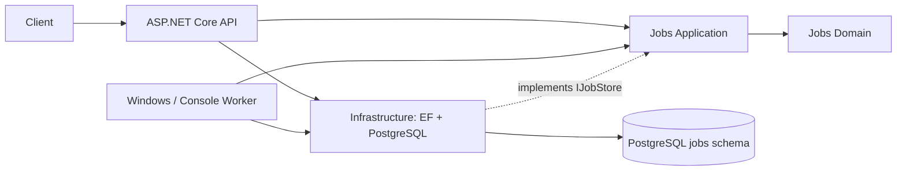

# Software architecture
One codebase and shared PostgreSQL instance, two independently hosted processes. Domain and Application have no persistence or host dependencies. Infrastructure implements the application-owned IJobStore. API and Worker are composition roots. No broker or Kubernetes.

The implemented Jobs module owns ProcessingJobs and AuditLogs. Query results expose immutable views; lease tokens never appear in API responses. Commands require the current version. Internal worker writes require an unexpired matching execution token. A lease fences database updates; it cannot undo future external side effects. Every future executor must use operation-specific idempotency and cancellation.

API requires a random shared key, uses constant-time comparison of key digests, validates commands with FluentValidation and returns problem details. Bind locally for development; role-based user authentication, TLS, quotas and request throttling are production work. Health endpoints return no detailed exception data. Readiness queries the migrated table; liveness is independent of database availability.

Structured logs use Serilog compact JSON. Worker logs optionally rotate by day and size with 14-file retention. Database progress/audit is authoritative for worker status; explicit worker heartbeat dashboard/metrics and log centralization remain later work.

Future boundaries: Media Management owns imports/assets; Video Processing owns probes/scenes; AI Analysis owns transcripts/analysis; Recap owns projects/scripts/segments; Localization owns localized versions; Voice/Subtitles owns speech and text assets; Rendering owns render jobs/outputs; Rights owns licenses/approvals; Publishing owns accounts/attempts/videos; Scheduling owns persistent Quartz triggers; Administration owns settings/read models. See module catalog and ADRs.

Phase 2 manual import adds Media Domain/Application and the module-owned `media` schema. Its Infrastructure adapters inspect trusted local folders and run FFprobe. API enqueues an import; worker inspects and atomically commits media + job completion through the Jobs Application `IJobTransaction` contract. Media persistence never reads Jobs tables directly. A repeatable-read snapshot assembles status through the same Jobs contract. No cross-module EF relationship is added. Rights metadata is import-scoped Media storage for this slice; a separate publication Rights service and scene processing remain future work. See ADR 0005.

Phase 2 folder discovery adds a worker-hosted monitor and Media-owned MediaDiscoveries. Coalesced filesystem hints request scans; startup/periodic reconciliation recovers missed events. Operators use authenticated inbox APIs to dismiss or submit a versioned candidate with explicit source/rights metadata. Submission atomically links the candidate and creates its import/rights/job/audit through existing contracts. File revisions retain history and bind execution to an expected metadata fingerprint. Discovery is opt-in and does not manufacture permissions or import jobs. See ADR 0006.

Phase 2 streams extend Media-owned probing/storage with immutable asset inventories and import-local selections/audits. Selection verifies source identity under a retained read-only handle and saves state/audit together under a row/version lock. Legacy inventories are not guessed: a media.stream-inspection job performs actual hash/probe verification and fenced persistence through Jobs Application contracts. Duplicate assets share inventory but have independent choices. Future scene/processing modules consume Media Application contracts; they do not query its tables. No stream extraction, decoding, scene detection or rendering is delivered. See ADR 0007.

